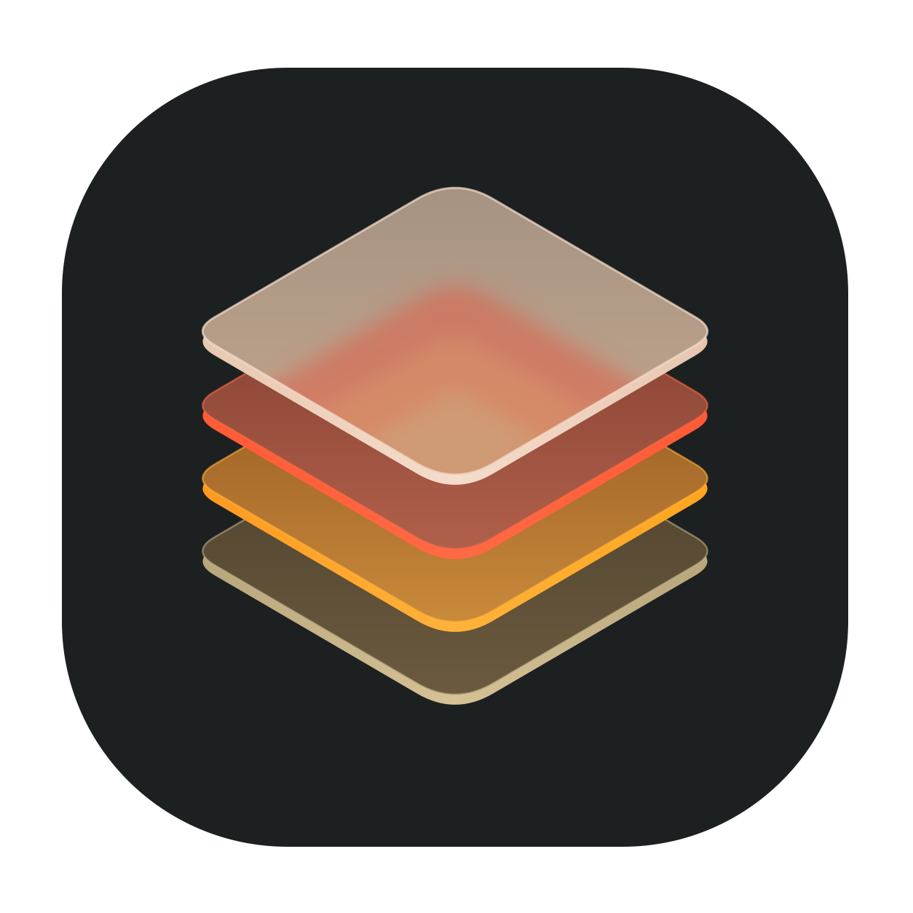

<p align="center">
  
</p>

<h1 align="center">gpui-template</h1>

<p align="center">
  A desktop app template built on <a href="https://www.gpui.rs">GPUI</a>, the UI framework behind Zed.
</p>

<p align="center">
  <a href="https://github.com/danielkosgei/gpui-template/actions/workflows/ci.yml"></a>
  <a href="https://crates.io/crates/gpui"></a>
  
  
  <a href="#license"></a>
  <a href="https://github.com/danielkosgei/gpui-template/commits/master"></a>
</p>

---

## Features

- **Custom titlebar** with the app icon, title and window controls, on Windows, Linux (Wayland and X11).
- **Gruvbox light and dark themes** that follow the system setting.

## Getting started

Requires a recent stable [Rust](https://rustup.rs) toolchain (edition 2024).

```sh
cargo run
```

For an optimized build:

```sh
cargo build --release
```

Release builds on Windows run without a console window; debug builds keep one for logs.

### Linux

GPUI needs a few system libraries to build. See
[Zed's Linux build guide](https://github.com/zed-industries/zed/blob/main/docs/src/development/linux.md)
for the package list for your distribution.

To force client-side decorations (for example on a compositor that would otherwise draw its own):

```sh
GPUI_TEMPLATE_WINDOW_DECORATIONS=client cargo run
```

To show the icon in your launcher and taskbar, install the desktop entry and icon:

```sh
install -Dm644 assets/gpui-template.desktop ~/.local/share/applications/gpui-template.desktop
install -Dm644 assets/icons/app-icon.svg ~/.local/share/icons/hicolor/scalable/apps/gpui-template.svg
```

The desktop entry runs `gpui-template`, so put `target/release/gpui-template` on your `PATH`.

## Project layout

```
assets/
  icons/                 App icon: app-icon.svg (source), PNG sizes and app-icon.ico
  gpui-template.desktop  Linux desktop entry
scripts/
  generate_icons.py      Regenerates the PNGs and .ico from app-icon.svg
src/
  main.rs                Entry point
  theme/                 Theme struct and the Gruvbox / One Dark palettes
  title_bar/             Custom titlebar and window controls (Windows and Linux)
  window_frame.rs        Client-side decorations and native border color
  workspace/             Main window, window options and theme switching
build.rs                 Embeds the icon in the Windows executable
.github/workflows/       CI: fmt, clippy and release build on Windows and Linux
```

## Customizing

### Changing the icon

Replace `assets/icons/app-icon.svg`, then regenerate the derived files (requires
`cargo install resvg`):

```sh
python scripts/generate_icons.py
```

### Changing the theme

Each theme is a constructor in `src/theme/`. `theme::sync_with_appearance` in `src/theme/mod.rs`
picks which one to use for light and dark mode. `Theme::one_dark()` is included as an alternative.

### Renaming the app

The name appears in `APP_NAME` (`src/main.rs`), the resource strings in `build.rs`, and
`assets/gpui-template.desktop`. The Linux app ID is derived from `APP_NAME` in lowercase and must
match the desktop entry's file name.

## License

Licensed under either of

- Apache License, Version 2.0 ([LICENSE-APACHE](LICENSE-APACHE) or
  <https://www.apache.org/licenses/LICENSE-2.0>)
- MIT license ([LICENSE-MIT](LICENSE-MIT) or <https://opensource.org/licenses/MIT>)

at your option.

Unless you explicitly state otherwise, any contribution intentionally submitted for inclusion in
this project by you, as defined in the Apache-2.0 license, shall be dual licensed as above, without
any additional terms or conditions.
