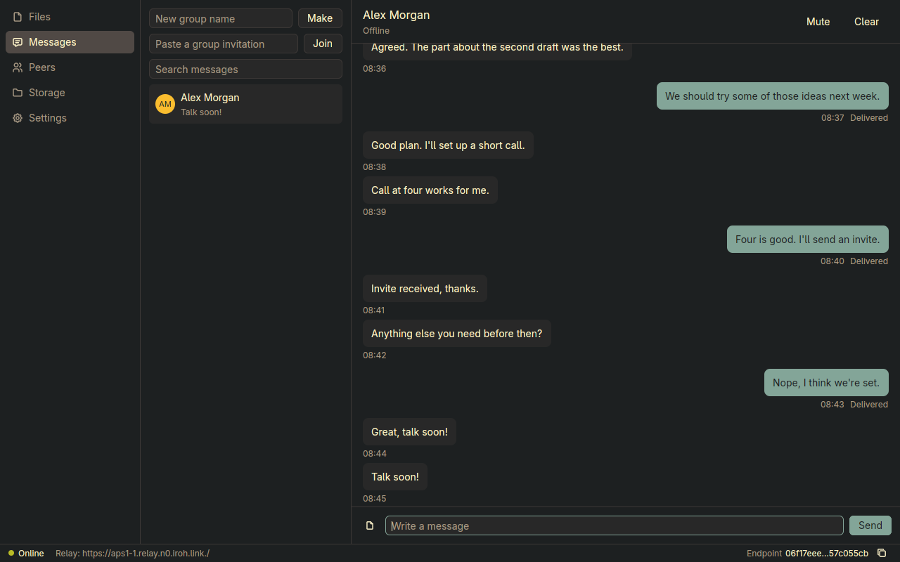
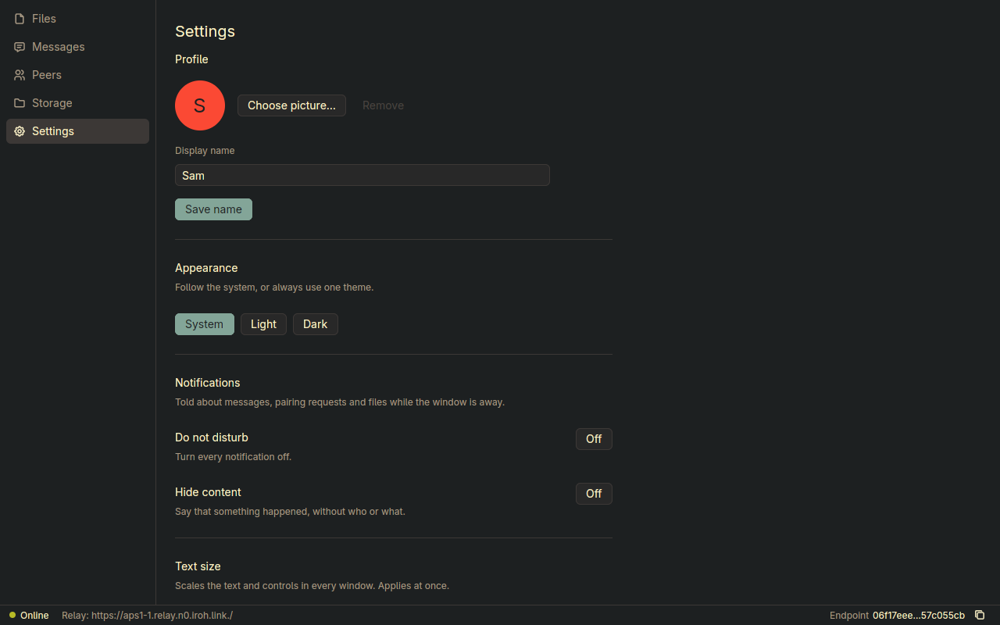

<p align="center">
  
</p>

<div align="center">

# Groovy

**A peer-to-peer platform for private file sharing, storage, and messaging, built on [iroh](https://iroh.computer).**

[](https://github.com/groovyapp/groovy/actions/workflows/ci.yml)
[](#roadmap)
[](CHANGELOG.md)
[](https://www.rust-lang.org/tools/install)
[](https://doc.rust-lang.org/edition-guide/rust-2024/index.html)
[](https://iroh.computer)
[](#license)

[Overview](#overview) · [Features](#features) · [Install](#install) · [Getting started](#getting-started) · [Roadmap](#roadmap) · [Contributing](#contributing)

</div>

---

## Overview

Groovy lets people and their devices share files, store data, and exchange messages **without relying on a central server to hold that data**. Peers connect directly, exchange end-to-end encrypted content, and keep control of where their files live.

Groovy's networking is built on [iroh](https://iroh.computer), an open-source Rust stack for connecting devices by public key. iroh establishes direct connections whenever possible, uses relay servers only as a fallback, and encrypts all traffic end to end. Groovy adds the sharing, storage, and messaging experience on top.

The goals are:

- **Privacy by default.** Content is encrypted in transit between peers, and relays forward only ciphertext.
- **No single point of control.** There is no central server that stores or can inspect user data.
- **Integrity.** Content is addressed by hash, so every received byte can be verified.
- **Simplicity.** One tool covers sharing, storage, and messaging.

> **Project status:** Groovy is in **alpha**. The first release, [0.1.0](CHANGELOG.md), works between people who trust each other. Local data is protected only by your operating system's disk encryption, so turn that on. The [threat model](docs/threat-model.md) says what Groovy does and does not protect. See the [Roadmap](#roadmap) for what is still open.

## Features

| Capability | How it works | Status |
| --- | --- | --- |
| **File sharing** | Send files and folders to a peer, with verified and resumable downloads, a transfer queue, and share links for one-off sharing | ✅ Built |
| **Shared folders** | Folders synced between members, with a choice of which devices keep a full copy and conflict copies when files are edited apart | ✅ Built |
| **Storage** | Replica status for each folder, storage quotas, and garbage collection that keeps what folders and messages need | ✅ Built |
| **Direct messaging** | Messages between contacts, with delivery states, an outbox that retries offline delivery, and attachments | ✅ Built |
| **Group chat** | Groups over gossip, with signed membership, admins and roles, and removal with a new group key | ✅ Built |
| **Search** | Search over your own message history, kept on the device | ✅ Built |
| **Identity and devices** | An Ed25519 identity, an encrypted backup, linking several devices to one user, and revoking a device | ✅ Built |
| **Contacts and pairing** | Pairing with a six-digit code both sides check, trust, blocking, and presence | ✅ Built |
| **Connectivity** | Address lookup that is private by default, self-hosted relays, and reconnection after network changes | ✅ Built |
| **Desktop app** | Notifications, a system tray with background mode, `groovy://` links, and keyboard navigation | ✅ Built |
| **Command line** | `groovy-cli` to send and receive files | ✅ Built |
| **Linux** | AppImage with launcher integration; Flatpak manifest, not yet built | 🟡 Partly |
| **Windows** | Unsigned zip, without an installer or link registration | 🟡 Partly |
| **macOS** | Not packaged yet | ⬜ Not started |

## Screenshots

A conversation with a contact, showing both sides and each message's delivery state:



The settings screen, with the profile, appearance and notification choices:



## Architecture

Groovy is a layered system. The lower layers come from iroh, and Groovy builds the services and clients on top.

```text
┌──────────────────────────────────────────────────────────────┐
│  Clients         CLI · Desktop · (future: mobile)            │
├──────────────────────────────────────────────────────────────┤
│  Services        File sharing · Storage · Messaging          │
├──────────────────────────────────────────────────────────────┤
│  Data protocols  iroh-blobs · iroh-docs · iroh-gossip        │
├──────────────────────────────────────────────────────────────┤
│  Transport       iroh endpoints · QUIC · Router (ALPN)       │
├──────────────────────────────────────────────────────────────┤
│  Infrastructure  iroh-relay · DNS / DHT / mDNS lookup        │
└──────────────────────────────────────────────────────────────┘
```

| Layer | Responsibility | Provided by |
| --- | --- | --- |
| **Infrastructure** | Relay fallback for connections that cannot go direct, and address lookup for finding peers. | iroh, with Groovy's own relay settings |
| **Transport** | Authenticated, end-to-end encrypted QUIC connections. Incoming connections are routed to protocol handlers by ALPN. | iroh |
| **Data protocols** | Content transfer, shared documents, and broadcast messaging. | iroh-blobs, iroh-docs, iroh-gossip |
| **Services** | Groovy's file sharing, storage and replication policy, and messaging rules. | Groovy |
| **Clients** | User interfaces for the command line and desktop. | Groovy |

### Identity and encryption

Every Groovy node is an iroh **endpoint** identified by an Ed25519 public key. Peers dial each other by that key rather than by IP address, and all traffic is encrypted end to end.

What is stored on this device, such as received files, shared folders and the database, is not encrypted by Groovy. It is protected only by the operating system's disk encryption, so turn that on. See [docs/decisions/0002-encryption-at-rest.md](docs/decisions/0002-encryption-at-rest.md).

### Privacy properties inherited from iroh

These follow from [iroh's security model](https://docs.iroh.computer/concepts/security-privacy). They are stated here so users can make informed decisions.

- **Relays forward ciphertext only.** A relay cannot read file contents, file names, or message contents. It can see the source and destination IP addresses, connection times, and the amount of data relayed, along with which device identities talk to each other.
- **Direct connections reveal IP addresses.** When two peers connect directly, they exchange their public IP addresses. Internal IP addresses are not published by default.
- **Public relays have no access control.** Any application that knows a public relay's URL can connect to it. n0 does not recommend public relays for production systems.

### How peers find each other

A peer is found by its endpoint ID through address lookup. Each service below reveals something, so they are set out here, and only the first is on by default:

- **Public address lookup (on).** Groovy publishes this device's ID and addresses to n0's DNS servers, and looks up peers there. n0 can see who looks up whom, and the addresses published.
- **Local network (off, Settings → Network).** Announces the ID and addresses to devices on the same network (mDNS). Anyone on that network can see them.
- **Internet directory (off, Settings → Network).** Publishes the ID and addresses to the public Mainline DHT. Anyone who knows the ID can look up its addresses.

Tickets carry the addresses at the time they are made, whatever the settings above.

To run your own relay, and point Groovy at it, see [docs/relay.md](docs/relay.md).

## Install

Download the latest release from the [releases page](https://github.com/groovyapp/groovy/releases):

- **Linux:** `Groovy-<version>-x86_64.AppImage`. Make it executable (`chmod +x`) and run it. The first run adds Groovy to your app launcher and registers `groovy://` links.
- **Windows:** `Groovy-<version>-windows-x86_64.zip`. Unzip it and run `groovy.exe`. Windows will warn that the app is from an unknown publisher, because releases are not code signed yet.
- **macOS:** not packaged yet.

Releases do not yet carry signatures, so there is nothing to check a download against. Download only from the releases page of this repository.

## Getting started

### Prerequisites

- [Rust](https://www.rust-lang.org/tools/install) **1.99.0 or newer**, with edition 2024 support. The pinned GPUI needs a recent toolchain: its `gpui_util` crate uses `slice_as_array`, which is not stable on 1.92. CI checks this exact version. iroh 1.3 alone needs only 1.91.
- Windows or Linux. CI builds and tests both.
- `git`, because GPUI is pulled from the [Zed repository](https://github.com/zed-industries/zed) at a pinned commit.
- On Linux, the system libraries listed in [CI](.github/workflows/ci.yml) (ALSA, fontconfig, Wayland, X11/xcb, xkbcommon, Vulkan, OpenSSL, zstd, D-Bus and pkg-config).

### Build from source

```bash
git clone https://github.com/groovyapp/groovy.git
cd groovy
cargo build
cargo run
```

For an optimized build:

```bash
cargo build --release
```

The binary is `target/release/groovy` (`groovy.exe` on Windows).

Groovy keeps its config and data in a per-user directory: `~/.local/share/groovy` on Linux, and the platform's equivalent elsewhere. To use a different directory, for example to run two instances on one machine, set `GROOVY_DATA_DIR`:

```bash
GROOVY_DATA_DIR=/tmp/groovy-b cargo run
```

Logs go to `logs/` in the data directory (one file per day, the most recent seven kept) and to stderr. Set `RUST_LOG` to change the level, for example `RUST_LOG=debug cargo run`. See [CONTRIBUTING.md](CONTRIBUTING.md#logging) for what must never be logged.

Release builds on Windows run without a console window; debug builds keep one for logs.

### Test

```bash
cargo test
```

### Lint and format

```bash
cargo fmt --check
cargo clippy --all-targets -- -D warnings
```

### Dependencies

The networking comes from [iroh](https://iroh.computer): `iroh` for endpoints, relays and address lookup, and the `iroh-blobs`, `iroh-docs` and `iroh-gossip` protocol crates. The exact versions are pinned in `Cargo.toml` and in `Cargo.lock`. Groovy's dependency licences and advisories are checked by `cargo deny check`, configured in `deny.toml`.

## Project layout

This is a Cargo workspace. `groovy-core` holds the UI-free services and must not depend on GPUI. `groovy` is the desktop app, built on [GPUI](https://www.gpui.rs), the UI framework behind Zed. `groovy-cli` is the command-line client for sending, receiving and listing peers. It uses the desktop app's data directory, so the two cannot run at the same time.

```
crates/
  groovy-core/           Core services (networking, storage, messaging). No GPUI dependency.
    src/config.rs        Versioned config.toml with unknown keys preserved
    src/logging.rs       Daily log file, stderr output and panic logging
    src/db.rs            SQLite database with versioned migrations
    src/profile.rs       Local profile: display name and avatar, stored in the database
    src/avatar.rs        Avatar pictures reduced to 128px PNG thumbnails, with input limits
    src/backup.rs        Passphrase-encrypted (age) backups of the identity key
    src/identity.rs      Ed25519 identity in the OS credential store, with a file fallback
      ui/                  Component kit (buttons, inputs, dialogs, toasts, menus, icons); see ui/mod.rs
    src/paths.rs         Data directory layout and GROOVY_DATA_DIR override
    src/protocol.rs      Groovy protocol: handshake, profile exchange, framing (see docs/protocol.md)
    src/ticket.rs        Tickets: encode, parse (ticket or groovy:// link), QR codes
    src/contacts.rs      Contacts: known peers, trust, blocking, and the connection gate
    src/pairing.rs       Pairing: verification codes and the request rate limit
    src/presence.rs      Presence: which trusted contacts are reachable, and how often to check
    src/blobs.rs         Blob serving: each request is decided, for trusted contacts and active shares
    src/shares.rs        Shares: content offered by ticket to anyone, until revoked
    src/files.rs         Files to send: imported as one collection that keeps each file's path
    src/transfers.rs     Transfer records: state and progress, kept in the database across restarts
  groovy/                Desktop app (GPUI)
    src/
      main.rs            Entry point
      data.rs            Opens the data directory and config before startup
      node.rs            Runs the Groovy node and forwards its events to the UI
      theme/             Theme struct and the Gruvbox / One Dark palettes
      title_bar/         Custom titlebar and window controls (Windows and Linux)
      window_frame.rs    Client-side decorations and native border color
      workspace/         Main window: sidebar, screens (Files, Messages, Peers, Storage, Settings) and the status bar
      onboarding.rs      First-run flow: welcome, display name, endpoint ID, backup note
      settings.rs          Settings screen: profile, appearance, network, identity, storage, advanced
      tickets.rs           Peers screen panel: this device's ticket as a QR code, and connect by pasting one
      settings_profile.rs  Profile section of Settings: display name and picture
      backup.rs            Identity backup and restore: restore form and Settings section
    build.rs             Embeds the icon in the Windows executable
assets/
  icons/                 App icon: app-icon.svg (source), PNG sizes and app-icon.ico
  icons/tabler/          Tabler outline icons used by the UI (MIT, see its LICENSE)
  io.github.groovyapp.Groovy.desktop   Linux desktop entry (also handles groovy:// links)
scripts/
  generate_icons.py      Regenerates the PNGs and .ico from app-icon.svg
.github/                 CI and release workflows, issue and pull request templates
CHANGELOG.md             Release history
CONTRIBUTING.md          How to contribute, and the rules for code that touches data
SECURITY.md              How to report a security problem privately
docs/
  decisions/             Architecture decision records (0001: SQLite for local state; 0002: encryption at rest relies on the OS)
  benchmarks.md          How to run the benchmarks, and the results
  storage.md             Storage model: shared folders, replication, garbage collection
  identity.md            One user across several devices, linking and revoking
  protocol.md            Groovy protocol: handshake, trust, pairing, presence, files, shares
  relay.md               Running your own relay
  threat-model.md        What Groovy protects, against whom, and what it does not protect
```

### Linux desktop entry

Packages for Linux are built with `scripts/package-appimage.sh` (an AppImage in `dist/`) and the Flatpak manifest in `packaging/flatpak/`. See `packaging/README.md`.

To run a build from source with its icon in your launcher and taskbar, install the desktop entry and icon:

```bash
install -Dm644 assets/io.github.groovyapp.Groovy.desktop ~/.local/share/applications/io.github.groovyapp.Groovy.desktop
install -Dm644 assets/icons/app-icon.svg ~/.local/share/icons/hicolor/scalable/apps/io.github.groovyapp.Groovy.svg
```

The desktop entry runs `groovy`, so put `target/release/groovy` on your `PATH`. To force client-side decorations on a compositor that draws its own:

```bash
GROOVY_WINDOW_DECORATIONS=client cargo run
```

## Customizing

### Renaming the app

The app name comes from the `name` field in `Cargo.toml`. `APP_NAME` in `src/main.rs` reads it at build time, and the Windows resource strings in `build.rs` use it too. To rename the app:

1. Change `name` in `Cargo.toml`.
2. Change `APP_ID` in `src/main.rs`, rename `assets/io.github.groovyapp.Groovy.desktop` and `packaging/linux/io.github.groovyapp.Groovy.metainfo.xml` to match, and update the desktop entry's `Name`, `Exec`, `Icon` and `StartupWMClass` fields.
3. Update the install paths in this README and the packaging files.

The Linux app ID is `APP_ID`, and must match the desktop entry's file name. The data directory is named after `APP_NAME`.

### Changing the icon

Replace `assets/icons/app-icon.svg`, then regenerate the derived files (requires `cargo install resvg`):

```bash
python scripts/generate_icons.py
```

### Changing the theme

Each theme is a constructor in `src/theme/`. `theme::sync_with_appearance` in `src/theme/mod.rs` picks which one to use for light and dark mode. `Theme::one_dark()` is included as an alternative.

### Updating GPUI

GPUI is pinned to a commit of [Zed](https://github.com/zed-industries/zed) in `Cargo.toml`, in both `gpui` and `gpui_platform`. To move to a newer GPUI, change the `rev` in both entries, then run `cargo check` and fix any API changes.

## Roadmap

| Phase | Milestone | Status |
| --- | --- | --- |
| **0** | Project scaffold, build, and tooling | ✅ Complete |
| **1** | Identity and endpoints: persistent keys, endpoint creation, ticket exchange | ✅ Complete |
| **2** | Connectivity: the Groovy protocol, relays, discovery settings, pairing and presence | ✅ Complete |
| **3** | File sharing: verified transfers, shares, and the CLI | ✅ Complete |
| **4** | Storage and replication: shared folders, replica status, and garbage collection | ✅ Complete |
| **5** | Messaging: direct messages, group chat, attachments, and search | ✅ Complete |
| **6** | Desktop release and public alpha: packaging, updates, security review, and the alpha checklist | 🟡 In progress |

Phase 6 is open on these issues: [Windows installer](https://github.com/groovyapp/groovy/issues/53), [macOS](https://github.com/groovyapp/groovy/issues/54), [update checks](https://github.com/groovyapp/groovy/issues/55), [security review](https://github.com/groovyapp/groovy/issues/57) and the [alpha checklist](https://github.com/groovyapp/groovy/issues/58). Release history is in the [changelog](CHANGELOG.md).

## Security

Groovy handles sensitive data, so security is a core requirement. Please **do not report security vulnerabilities in public issues**. Contact the maintainer privately so the issue can be fixed before disclosure.

Groovy depends on iroh for transport security. Vulnerabilities in iroh itself should be reported to the iroh maintainers, n0 computer, through their channels.

Report security problems privately, through [SECURITY.md](SECURITY.md). The [threat model](docs/threat-model.md) says what Groovy protects, against whom, and what it does not protect. The [protocol design](docs/protocol.md) describes the messages between devices. This is still an alpha: **do not use Groovy to protect data you cannot afford to lose or expose.**

## Contributing

Contributions are welcome. Read [CONTRIBUTING.md](CONTRIBUTING.md) first: it covers the checks to run, the rules for code that touches data, and how releases are cut. Use the issue templates for bugs and ideas.

## License

Licensed under either of

- Apache License, Version 2.0 ([LICENSE-APACHE](LICENSE-APACHE) or <https://www.apache.org/licenses/LICENSE-2.0>)
- MIT license ([LICENSE-MIT](LICENSE-MIT) or <https://opensource.org/licenses/MIT>)

at your option.

Unless you explicitly state otherwise, any contribution intentionally submitted for inclusion in this project by you, as defined in the Apache-2.0 license, shall be dual licensed as above, without any additional terms or conditions.

Groovy's dependencies are licensed separately. iroh and its protocol crates are dual-licensed under MIT OR Apache-2.0.

## Acknowledgements

Groovy is built on [iroh](https://iroh.computer) by [n0 computer](https://n0.computer).

---

<div align="center">

Built with 🦀 Rust · Powered by iroh · Made for peers

</div>
